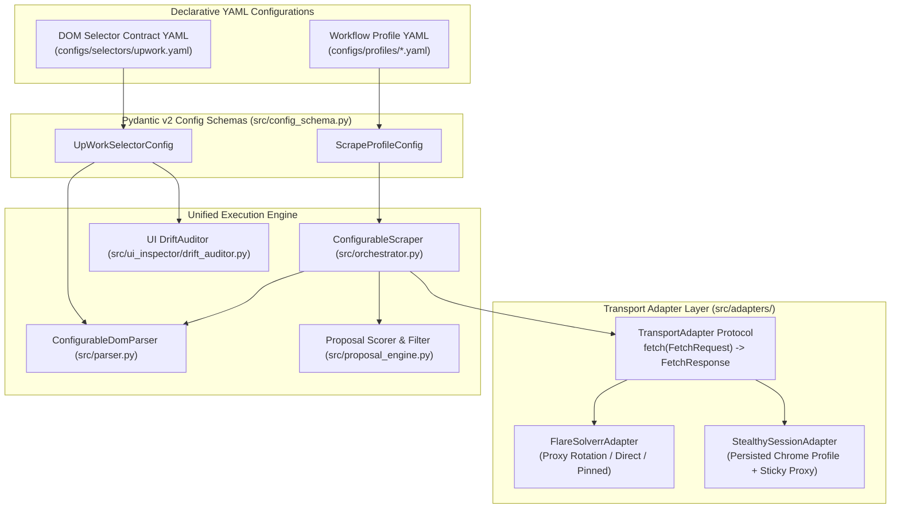

# UpWork Scraper: YAML-Driven Adapter & Pipeline Configuration Plan

## 1. Executive Summary & Architectural Motivation

Currently, the codebase contains multiple hard-coded scraping scripts and duplicated extraction contracts:
1. **Fragmented Workflow Scripts**:
   - [`src/main.py`](file:///var/www/upwork-scraper-fs/src/main.py) + [`src/orchestrator.py`](file:///var/www/upwork-scraper-fs/src/orchestrator.py): Single-page search or full-page detail enrichment via FlareSolverr with proxy rotation.
   - [`scrape_50.py`](file:///var/www/upwork-scraper-fs/scrape_50.py): Hard-coded loop for 50 `wordpress` jobs sorted by `recency`, running FlareSolverr without proxies (`proxies=[]`), with manual URL deduplication.
   - [`src/scrape_wordpress.py`](file:///var/www/upwork-scraper-fs/src/scrape_wordpress.py): Hard-coded multi-page loop (`--pages 10`, `--min-jobs 200`, `15s` delay) saving per-page and combined JSON files.
   - [`src/scrape_top_details.py`](file:///var/www/upwork-scraper-fs/src/scrape_top_details.py): Hard-coded two-stage workflow that loads previously scraped jobs, filters by `score >= 40` and `posted_age <= 21 days`, scrapes the top 20 detail pages, merges fields, and re-scores.
2. **Tightly Coupled Transport Backends**:
   - [`UpWorkScraper`](file:///var/www/upwork-scraper-fs/src/orchestrator.py#L28) instantiates [`FlareSolverrClient`](file:///var/www/upwork-scraper-fs/src/flaresolverr_client.py#L35) directly, whereas [`UpWorkUIEngine`](file:///var/www/upwork-scraper-fs/src/ui_inspector/engine.py) uses [`UpWorkSessionManager`](file:///var/www/upwork-scraper-fs/src/ui_inspector/session_manager.py) (Scrapling's `StealthySession` with persistent `user_data_dir` and sticky proxy pinning). Switching a job scrape from FlareSolverr to a persistent authenticated Scrapling session currently requires writing new Python code.
3. **Duplicated DOM Selectors**:
   - [`src/parser.py`](file:///var/www/upwork-scraper-fs/src/parser.py) hard-codes CSS selectors and post-processing rules in imperative Python, while [`src/ui_inspector/selector_registry.py`](file:///var/www/upwork-scraper-fs/src/ui_inspector/selector_registry.py) maintains a separate `CORE_PARSER_REGISTRY` list for drift auditing.

### Target Architecture
We will introduce a **three-tier YAML-driven adapter architecture**:
1. **Transport Adapter Layer (`src/adapters/`)**: A common `TransportAdapter` interface implemented by `FlareSolverrAdapter` and `StealthySessionAdapter`.
2. **Declarative Selector & Extraction Schema (`configs/selectors/upwork.yaml`)**: A single YAML source of truth for DOM selectors, fallback chains, extraction modes, 404 guards, and field transforms—shared by both the core parser and the UI Drift Auditor.
3. **Declarative Workflow Profile Schema (`configs/profiles/*.yaml`)**: Validated YAML configs defining transport settings, search/sort/pagination parameters, deduplication, scoring/filtering thresholds, and detail-page enrichment, executed by a unified `ConfigurableScraper` runner.

---

## 2. System Architecture Diagram



---

## 3. Directory & File Structure

```text
/var/www/upwork-scraper-fs/
├── configs/
│   ├── selectors/
│   │   └── upwork.yaml                      # Single source of truth for DOM selectors, transforms & 404 guards
│   └── profiles/
│       ├── default_search.yaml              # Standard single/multi-page search via FlareSolverr
│       ├── wordpress_latest_50.yaml         # Replaces scrape_50.py (sort=recency, target_jobs=50, deduplicate=true)
│       ├── wordpress_multi_page.yaml        # Replaces src/scrape_wordpress.py (max_pages=10, target_jobs=200)
│       ├── wordpress_top20_enriched.yaml    # Replaces src/scrape_top_details.py (score>=40, age<=21d, enrich top 20)
│       └── authenticated_search.yaml        # Scrapes via persistent StealthySessionAdapter
├── src/
│   ├── adapters/
│   │   ├── __init__.py                      # Exports TransportAdapter, FetchRequest, FetchResponse, create_adapter
│   │   ├── base.py                          # TransportAdapter Protocol, FetchRequest, FetchResponse models
│   │   ├── flaresolverr_adapter.py          # FlareSolverrAdapter (wraps FlareSolverrClient with retry & proxy modes)
│   │   └── stealthy_adapter.py              # StealthySessionAdapter (wraps UpWorkSessionManager for job scraping)
│   ├── config_schema.py                     # Pydantic v2 models for ScrapeProfileConfig & UpWorkSelectorConfig
│   ├── parser.py                            # Driven by UpWorkSelectorConfig (maintains backward-compatible functions)
│   ├── orchestrator.py                      # ConfigurableScraper + backward-compatible UpWorkScraper wrapper
│   ├── main.py                              # CLI supporting --config <profile.yaml> + CLI flag overrides
│   └── ui_inspector/
│       └── selector_registry.py             # Loads CORE_PARSER_REGISTRY directly from configs/selectors/upwork.yaml
└── tests/
    ├── test_adapters_and_config.py          # Unit tests for YAML loading, adapters, parser rules, and pipeline runner
    └── test_ui_inspector.py                 # Existing UI inspector & parser tests
```

---

## 4. Layer 1: Common Transport Adapter Interface (`src/adapters/`)

### 4.1 Request / Response Contract (`src/adapters/base.py`)
All scraping backends normalize their I/O to `FetchRequest` and `FetchResponse` and implement the `TransportAdapter` protocol:

```python
from __future__ import annotations

from dataclasses import dataclass, field
from typing import Any, Protocol, runtime_checkable


@dataclass(frozen=True)
class FetchRequest:
    """Normalized request payload for any scraping transport adapter."""

    url: str
    wait_selector: str | None = None
    auto_scroll: bool = False
    max_ scrolls: int = 4
    scroll_delay_ms: int = 1200
    timeout_ms: int = 60000
    return_raw_html: bool = True


@dataclass
class FetchResponse:
    """Normalized response returned by a TransportAdapter."""

    url: str
    status: int
    html: str
    error: str | None = None
    session_id: str | None = None
    cookies: list[dict[str, Any]] = field(default_factory=list)
    elapsed_seconds: float = 0.0
    adapter_name: str = ""

    @property
    def ok(self) -> bool:
        return self.error is None and 200 <= self.status < 300 and bool(self.html.strip())


@runtime_checkable
class TransportAdapter(Protocol):
    """Common interface that all scraping transport backends must satisfy."""

    adapter_name: str

    def fetch(self, request: FetchRequest) -> FetchResponse:
        """Fetch a target URL and return rendered HTML."""
        ...

    def close(self) -> None:
        """Release underlying browser sessions or HTTP clients."""
        ...
```

### 4.2 Concrete Adapters
1. **`FlareSolverrAdapter` (`src/adapters/flaresolverr_adapter.py`)**:
   - Wraps [`FlareSolverrClient`](file:///var/www/upwork-scraper-fs/src/flaresolverr_client.py).
   - Supports three `proxy_mode` configurations via YAML:
     - `"rotation"`: Round-robin across proxies loaded from `proxy_file`.
     - `"pinned"`: Pins all requests to `proxy_index` or `proxy_url`.
     - `"direct"`: Uses no proxies (`proxies=[]`), matching the behavior in `scrape_50.py`.
   - Handles configurable retry/backoff (`max_retries`, `retry_backoff_seconds`).
2. **`StealthySessionAdapter` (`src/adapters/stealthy_adapter.py`)**:
   - Wraps [`UpWorkSessionManager`](file:///var/www/upwork-scraper-fs/src/ui_inspector/session_manager.py) and Scrapling's `StealthySession`.
   - Reuses the persistent Chrome profile (`.session/chrome_profile`), sticky proxy (`session_meta.json`), and cookie backup (`.session/storage_state.json`).
   - Supports lazy session startup so a single `StealthySession` browser instance stays open across paginated requests or detail page fetches, and cleanly closes on `adapter.close()`.

---

## 5. Layer 2: Declarative Selector & Extraction YAML (`configs/selectors/upwork.yaml`)

Instead of splitting selector knowledge between [`src/parser.py`](file:///var/www/upwork-scraper-fs/src/parser.py) and [`src/ui_inspector/selector_registry.py`](file:///var/www/upwork-scraper-fs/src/ui_inspector/selector_registry.py), both modules will load `configs/selectors/upwork.yaml`.

### 5.1 Selector YAML Structure
```yaml
version: "1.0"
site: "upwork"
base_url: "https://www.upwork.com"

# 404 / Expired / Unavailable page detection rules
page_guards:
  not_found_headings:
    - "job not found"
    - "this job is no longer available"
    - "this job is private"
    - "page not found"
    - "we can't find the page"
    - "access denied"
  error_heading_selectors:
    - "h1"
    - "h2"
    - "[data-test='error-title']"
    - ".air3-alert"
  detail_signal_selectors:
    - "[data-cy='clock-timelog']"
    - "[data-cy='fixed-price']"
    - "[data-cy='expertise']"
    - "[data-qa='client-location']"

views:
  search_listings:
    container_selectors:
      - "article.job-tile"
      - "article[data-test*='JobTile']"
    fields:
      title:
        selectors:
          - "a[data-test*='job-tile-title-link']"
        extract: "full_text"
        required: true
        description: "Anchor tag holding job title and relative URL"
      url:
        selectors:
          - "a[data-test*='job-tile-title-link']"
        extract: "attribute"
        attribute: "href"
        transforms:
          - "normalize_job_url"
        description: "Canonicalized job detail URL"
      description:
        selectors:
          - "[data-test*='JobDescription'] p"
          - "[data-test*='JobDescription']"
        extract: "text"
        description: "Snippet paragraph inside job description container"
      budget:
        selectors:
          - "[data-test='is-fixed-price']"
        extract: "full_text"
        transforms:
          - "strip_est_budget_prefix"
        description: "Fixed-price estimated budget"
      hourly_rate:
        selectors:
          - "[data-test='job-type-label'] strong"
          - "[data-test='job-type-label']"
        extract: "hourly_or_fixed_label"
        description: "Hourly rate or budget label text"
      experience_level:
        selectors:
          - "[data-test='experience-level'] strong"
          - "[data-test='experience-level']"
        extract: "text"
        description: "Experience level (Intermediate, Expert, Entry level)"
      duration:
        selectors:
          - "[data-test='duration-label']"
        extract: "text"
        transforms:
          - "strip_est_time_prefix"
        description: "Estimated duration for hourly contracts"
      skills:
        selectors:
          - "[data-test='token'] span"
          - ".air3-token span"
        extract: "list"
        description: "Skill tags listed on the card"
      posted:
        selectors:
          - "[data-test='job-pubilshed-date'] span"
          - "[data-test='job-published-date'] span"
        extract: "text"
        is_fragile: true
        fragile_reason: "Includes legacy UpWork typo 'pubilshed' alongside 'published'"
        description: "Posted relative timestamp"
      country:
        selectors:
          - "[data-qa='client-location']"
          - "[data-test='client-country']"
        extract: "text"
        auth_only: true
        description: "Client country/location on card"
      proposals:
        selectors:
          - "[data-test='proposals-tier']"
          - "[data-test='proposals']"
        extract: "text"
        auth_only: true
        description: "Proposal count tier on card"
      client_rating:
        selectors:
          - "[data-qa='client-rating']"
          - "[data-test='client-rating']"
        extract: "text"
        transforms:
          - "first_token_float"
        auth_only: true
        description: "Client rating float on card"

  job_detail:
    fields:
      title:
        selectors:
          - "h1"
          - ".air3-card-section h4"
        extract: "full_text"
        required: true
        description: "Job headline on detail page"
      description:
        selectors:
          - "[data-test='Description'] p.multiline-text"
          - "[data-test='Description']"
        extract: "full_text"
        transforms:
          - "strip_summary_prefix"
        description: "Full multiline job description"
      posted:
        selectors:
          - ".posted-on-line span"
          - "[data-test='posted-on']"
        extract: "text"
        description: "Detailed posted timestamp line"
      hourly_rate:
        selectors:
          - "[data-cy='clock-timelog']"
        extract: "sibling_text"
        sibling_child_tag: "strong"
        join_with: " - "
        description: "Hourly rate icon container with sibling <strong>"
      budget:
        selectors:
          - "[data-cy='fixed-price']"
        extract: "sibling_text"
        sibling_child_tag: "strong"
        description: "Fixed-price icon container with sibling <strong>"
      experience_level:
        selectors:
          - "[data-cy='expertise']"
        extract: "sibling_text"
        sibling_child_tag: "strong"
        description: "Expertise level icon container with sibling <strong>"
      duration:
        selectors:
          - "[data-cy='duration2']"
        extract: "sibling_text"
        sibling_child_tag: "strong"
        description: "Duration icon container with sibling <strong>"
      hours_per_week:
        selectors:
          - "[data-cy='clock-hourly']"
        extract: "sibling_text"
        sibling_child_tag: "strong"
        description: "Hours per week icon container with sibling <strong>"
      skills:
        selectors:
          - ".skills-list .air3-line-clamp"
          - "[data-test='Skill'] span"
          - ".air3-badge-highlight .air3-line-clamp"
          - "section[data-v-3b2c2248] .skills-list .air3-line-clamp"
        extract: "list"
        is_fragile: true
        fragile_reason: "Includes fallback to Vue scope hash data-v-3b2c2248"
        description: "Skills list on job detail page"
      proposals:
        selectors:
          - "li.ca-item"
        extract: "ca_item_value"
        label_contains: "Proposals"
        description: "Activity list item containing 'Proposals'"
      client_rating:
        selectors:
          - ".air3-rating-background"
          - "[data-qa='client-rating']"
        extract: "full_text"
        transforms:
          - "rating_out_of_5_float"
        description: "Client rating out of 5"
      country:
        selectors:
          - "li[data-qa='client-location']"
          - "[data-test='client-country']"
        extract: "text"
        description: "Client country/location item"
      client_spent:
        selectors:
          - "[data-qa='client-spend']"
          - "[data-test='client-spend']"
        extract: "full_text"
        transforms:
          - "strip_total_suffix"
        description: "Client total spent badge"
      client_hires:
        selectors:
          - "[data-qa='client-hires']"
          - "[data-test='client-hires']"
        extract: "text"
        transforms:
          - "first_token_int"
        description: "Client total hires badge"
```

### 5.2 Integration with `src/parser.py` & `src/ui_inspector/`
- **`ConfigurableDomParser`** in [`src/parser.py`](file:///var/www/upwork-scraper-fs/src/parser.py) loads `configs/selectors/upwork.yaml` (cached by default, or custom path passed in) and executes the configured selector fallback chains and named transforms.
- Existing top-level functions `parse_job_listings(html, session_id)` and `parse_job_detail(html, session_id)` delegate to the default `ConfigurableDomParser` instance so all existing callers and unit tests continue to work without modification.
- [`src/ui_inspector/selector_registry.py`](file:///var/www/upwork-scraper-fs/src/ui_inspector/selector_registry.py) builds `CORE_PARSER_REGISTRY` dynamically from `configs/selectors/upwork.yaml`. Updating a selector in `upwork.yaml` immediately updates both the scraper parser and the UI Drift Auditor.

---

## 6. Layer 3: Scraping Workflow Profile YAML (`configs/profiles/*.yaml`)

Each scraping strategy is expressed as a declarative YAML file validated by `ScrapeProfileConfig` in `src/config_schema.py`.

### 6.1 Profile Schema Example (`configs/profiles/wordpress_latest_50.yaml`)
```yaml
name: "wordpress_latest_50"
description: "Scrape the latest 50 WordPress jobs sorted by recency with URL deduplication"
selectors_file: "configs/selectors/upwork.yaml"

transport:
  adapter: "flaresolverr"          # "flaresolverr" | "stealthy_session"
  proxy_mode: "direct"             # "rotation" | "pinned" | "direct"
  max_timeout_ms: 60000
  max_retries: 3
  retry_backoff_seconds: 2.0

search:
  mode: "live_search"              # "live_search" | "from_saved_output"
  query: "wordpress"
  sort: "recency"                  # "recency" | "relevance" | null
  start_page: 1
  max_pages: 10
  target_jobs: 50                  # Stop early once 50 unique jobs are collected
  delay_between_pages_seconds: 5.0
  deduplicate_by_url: true

filters:
  required_keywords: []
  min_score: null                  # Optional pre-enrichment score threshold (e.g. 40)
  max_posted_age_days: null        # Optional age filter (e.g. 21)

enrichment:
  enabled: false                   # Set true for two-phase detail scraping
  max_jobs_to_enrich: null         # e.g. 20 for top-20 detail enrichment
  detail_retries: 2
  delay_between_details_seconds: 2.0
  compute_proposal_scores: false

output:
  directory: "output"
  filename_prefix: "wordpress_latest_50"
  save_per_page: false
  save_combined: true
```

### 6.2 How Legacy Scripts Map to YAML Profiles

| Legacy Script | Replacement YAML Profile | Key Settings |
| :--- | :--- | :--- |
| `src/main.py -q "golang developer"` | `configs/profiles/default_search.yaml` | `adapter: flaresolverr`, `proxy_mode: rotation`, `max_pages: 1` |
| `scrape_50.py` | `configs/profiles/wordpress_latest_50.yaml` | `query: wordpress`, `sort: recency`, `proxy_mode: direct`, `target_jobs: 50`, `deduplicate_by_url: true` |
| `src/scrape_wordpress.py` | `configs/profiles/wordpress_multi_page.yaml` | `query: wordpress`, `proxy_mode: rotation`, `max_pages: 10`, `target_jobs: 200`, `delay_between_pages_seconds: 15.0`, `save_per_page: true` |
| `src/scrape_top_details.py` | `configs/profiles/wordpress_top20_enriched.yaml` | `mode: from_saved_output`, `min_score: 40`, `max_posted_age_days: 21`, `enrichment.enabled: true`, `max_jobs_to_enrich: 20`, `compute_proposal_scores: true` |
| Authenticated session scrape | `configs/profiles/authenticated_search.yaml` | `adapter: stealthy_session`, `proxy_mode: pinned`, `auto_scroll: true` |

---

## 7. Layer 4: Unified Runner & CLI (`src/orchestrator.py` & `src/main.py`)

### 7.1 `ConfigurableScraper` Pipeline (`src/orchestrator.py`)
`ConfigurableScraper` accepts a `ScrapeProfileConfig` (and optional custom `TransportAdapter` for dependency injection in tests) and executes a deterministic 4-stage pipeline:
1. **Stage 1 — Acquisition (`live_search` or `from_saved_output`)**:
   - If `live_search`: Iterates from `start_page` to `max_pages`, builds the search URL (with optional `&sort=...`), fetches HTML via `self.adapter.fetch(...)`, parses cards using `ConfigurableDomParser`, deduplicates by normalized URL if `deduplicate_by_url` is enabled, optionally saves per-page outputs, and stops early when `len(jobs) >= target_jobs`.
   - If `from_saved_output`: Loads existing jobs via `proposal_engine.load_jobs()` to support offline filtering + detail enrichment workflows.
2. **Stage 2 — Scoring & Filtering**:
   - Computes initial proposal scores via `proposal_engine.score_job()` when `compute_proposal_scores` or `min_score` is configured.
   - Filters jobs by `required_keywords`, `min_score`, and `max_posted_age_days`.
3. **Stage 3 — Detail Page Enrichment (Optional)**:
   - When `enrichment.enabled` is `True`, slices up to `max_jobs_to_enrich` jobs, fetches each normalized job detail URL via `self.adapter.fetch(...)`, parses with `parser.parse_job_detail(...)`, merges non-empty detail fields onto the job record, and re-scores if `compute_proposal_scores` is enabled.
4. **Stage 4 — Output Persistence**:
   - Writes the final job list to `output/{filename_prefix}_{timestamp}.json`.

### 7.2 CLI Ergonomics (`src/main.py`)
`src/main.py` will support running any YAML profile while allowing CLI flags to override profile parameters on the fly:

```bash
# Run a named profile directly
uv run python -m src.main --config configs/profiles/wordpress_latest_50.yaml

# Run default profile with CLI overrides
uv run python -m src.main --query "rust developer" --max-pages 3 --target-jobs 30

# Switch transport backend on the fly (e.g. use persistent Scrapling session instead of FlareSolverr)
uv run python -m src.main --config configs/profiles/default_search.yaml --adapter stealthy_session

# Run the top-20 detail enrichment profile
uv run python -m src.main --config configs/profiles/wordpress_top20_enriched.yaml
```

 Legacy entrypoints (`scrape_50.py`, `src/scrape_wordpress.py`, `src/scrape_top_details.py`) will be refactored into thin wrappers that load their corresponding YAML profile and delegate to `ConfigurableScraper`, preserving backward compatibility for any existing shell commands or cron jobs.

---

## 8. Implementation Steps & Verification Plan

1. **Step 1 — Create Pydantic Config Schemas (`src/config_schema.py`)**:
   - Define `UpWorkSelectorConfig`, `ViewSelectorConfig`, `FieldSelectorRule`, `PageGuardConfig`, `TransportConfig`, `SearchWorkflowConfig`, `FilterWorkflowConfig`, `EnrichmentWorkflowConfig`, `OutputWorkflowConfig`, and `ScrapeProfileConfig`.
   - Implement `load_selector_config()` and `load_profile_config()` YAML loaders.
2. **Step 2 — Create YAML Configurations (`configs/`)**:
   - Author `configs/selectors/upwork.yaml` with all search card and job detail selectors, transforms, and 404 guards.
   - Author the 5 workflow profiles in `configs/profiles/*.yaml`.
3. **Step 3 — Implement Transport Adapters (`src/adapters/`)**:
   - Create `src/adapters/base.py`, `src/adapters/flaresolverr_adapter.py`, `src/adapters/stealthy_adapter.py`, and factory `src/adapters/__init__.py`.
4. **Step 4 — Refactor Parser & UI Drift Registry to Use `configs/selectors/upwork.yaml`**:
   - Update [`src/parser.py`](file:///var/www/upwork-scraper-fs/src/parser.py) to execute field rules from `UpWorkSelectorConfig`.
   - Update [`src/ui_inspector/selector_registry.py`](file:///var/www/upwork-scraper-fs/src/ui_inspector/selector_registry.py) to populate `CORE_PARSER_REGISTRY` from `configs/selectors/upwork.yaml`.
5. **Step 5 — Implement `ConfigurableScraper` & Update CLI / Legacy Scripts**:
   - Add `ConfigurableScraper` to [`src/orchestrator.py`](file:///var/www/upwork-scraper-fs/src/orchestrator.py) while keeping `UpWorkScraper` intact as a compatible facade.
   - Enhance [`src/main.py`](file:///var/www/upwork-scraper-fs/src/main.py) with `--config`, `--adapter`, `--max-pages`, `--target-jobs`, and `--sort`.
   - Delegate [`scrape_50.py`](file:///var/www/upwork-scraper-fs/scrape_50.py), [`src/scrape_wordpress.py`](file:///var/www/upwork-scraper-fs/src/scrape_wordpress.py), and [`src/scrape_top_details.py`](file:///var/www/upwork-scraper-fs/src/scrape_top_details.py) to their respective YAML profiles.
6. **Step 6 — Testing & Static Analysis**:
   - Add comprehensive unit tests in `tests/test_adapters_and_config.py` (testing YAML validation, mock `TransportAdapter` injection, pagination & deduplication, detail enrichment, and selector YAML parity with `DriftAuditor`).
   - Run `uv run ruff check`, `uv run pyright`, and `uv run pytest -v`.
