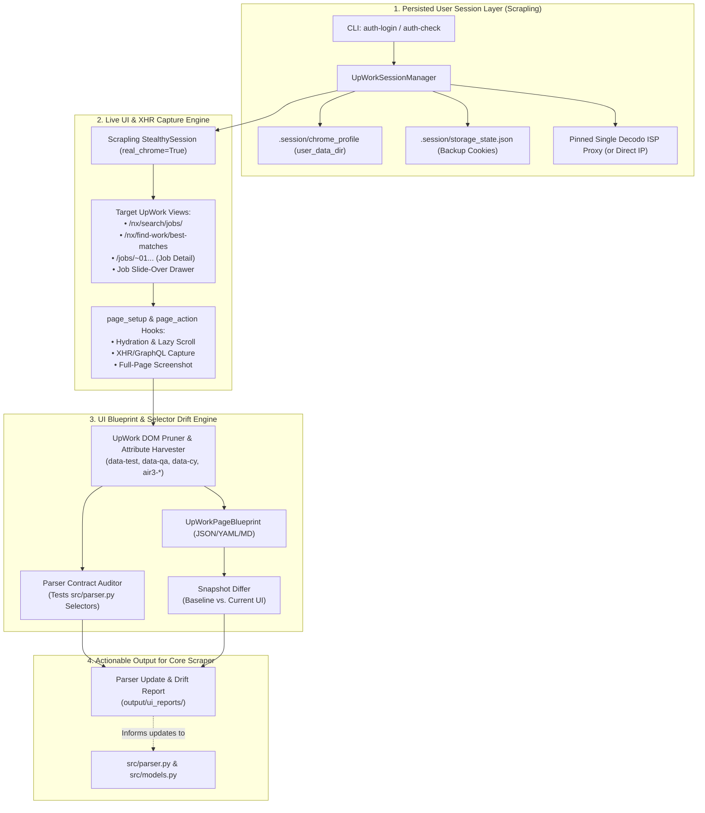

# Implementation Plan: Authenticated UpWork UI Scraper & Parser Drift Auditor

## 1. Objective & Architectural Vision

UpWork frequently updates its Nuxt/Vue (`Air3` design system) frontend—changing `data-test`, `data-qa`, `data-cy` attributes, scoped Vue hashes (e.g., `section[data-v-3b2c2248]`), and DOM hierarchy—which causes silent field drops or complete parsing failures in [`src/parser.py`](file:///var/www/upwork-scraper-fs/src/parser.py). Additionally, unauthenticated scraping via FlareSolverr omits critical fields that UpWork only renders for logged-in freelancers (e.g., client rating, payment verification, client spend/country on search cards, connects required, proposal tiers, and Best Matches feeds).

This plan defines an **independent, integrated UpWork UI Scraper & Drift Auditor** (`src/ui_inspector/`) built directly inside `/var/www/upwork-scraper-fs` by combining:
1. **Scrapling's persistent browser session engine** (`StealthySession` with `user_data_dir`, `real_chrome=True`, `solve_cloudflare=True`, `capture_xhr`, and sticky proxy pinning from `/var/www/edfx-labs/ui-engineer/src/ui_sleuth/scrapling_engine.py` and `proxy_manager.py`).
2. **Semantic DOM pruning & repetitive pattern recognition** (adapted from `/var/www/edfx-labs/ui-engineer/src/ui_sleuth/dom_pruner.py`) tailored to UpWork's `data-test`, `data-qa`, `data-cy`, and `air3-*` component trees.
3. **Automated Selector Health & UI Drift Detection** that validates [`src/parser.py`](file:///var/www/upwork-scraper-fs/src/parser.py) against live authenticated UpWork pages, detects UI changes across snapshots, discovers candidate replacement selectors, and outputs actionable Markdown/JSON parser update reports.

---

## 2. System Architecture



---

## 3. Dependency & Environment Updates

### 3.1 `pyproject.toml` Upgrades
The current project depends on `scrapling>=0.4.9` (which only installs the parser). To run Scrapling's browser session engine (`StealthySession` / `DynamicSession`) and structured CLI reporting like `ui-engineer`, update [`pyproject.toml`](file:///var/www/upwork-scraper-fs/pyproject.toml):
- Upgrade `scrapling` to `scrapling[fetchers]>=0.4.15`
- Add `pydantic>=2.10.0` (for structured UI blueprints and drift schemas, matching `ui-engineer`)
- Add `rich>=13.9.0` (for terminal diff tables and selector health dashboards)
- Add `pyyaml>=6.0.2` (optional blueprint serialization)

### 3.2 `.env` & `.gitignore` Additions
Add session and UI inspector settings to [`.env.example`](file:///var/www/upwork-scraper-fs/.env.example) and [`src/config.py`](file:///var/www/upwork-scraper-fs/src/config.py):
```ini
# Persisted Scrapling User Session
UPWORK_USER_DATA_DIR=./.session/chrome_profile
UPWORK_STORAGE_STATE=./.session/storage_state.json
# Sticky proxy index or explicit URL (MUST NOT rotate mid-session for logged-in accounts)
UPWORK_SESSION_PROXY_URL=
# Optional CDP URL to attach to an already-open local Chrome instance
UPWORK_CDP_URL=
# UI Inspector output directory
UI_REPORT_DIR=./output/ui_reports
```
Update [`.gitignore`](file:///var/www/upwork-scraper-fs/.gitignore) to exclude `.session/` so authenticated browser profiles and cookies are never committed.

---

## 4. Proposed Module Structure

All new functionality lives in an independent subpackage `src/ui_inspector/` so it cleanly coexists with the core job scraper while sharing [`src/config.py`](file:///var/www/upwork-scraper-fs/src/config.py), [`src/models.py`](file:///var/www/upwork-scraper-fs/src/models.py), and [`src/parser.py`](file:///var/www/upwork-scraper-fs/src/parser.py):

```text
/var/www/upwork-scraper-fs/
├── .session/                          # Git-ignored persistent Chrome user_data_dir & cookie backups
├── baselines/                         # Committed/versioned known-good UpWork UI blueprints
│   ├── search_jobs_baseline.json
│   ├── job_detail_baseline.json
│   └── find_work_baseline.json
├── src/
│   ├── config.py                      # Extended with session & UI inspector config keys
│   ├── models.py                      # Core job models (updated when new UI fields are promoted)
│   ├── parser.py                      # Core job parser (target of selector audits)
│   └── ui_inspector/                  # NEW: Independent UpWork UI Scraper & Auditor
│       ├── __init__.py
│       ├── cli.py                     # CLI entrypoint (`python -m src.ui_inspector`)
│       ├── session_manager.py         # Scrapling StealthySession + user_data_dir + auth lifecycle
│       ├── proxy_pinning.py           # Adapted from ui-engineer proxy_manager.py (sticky session proxy)
│       ├── engine.py                  # Adapted from ui-engineer scrapling_engine.py for UpWork UI
│       ├── dom_blueprint.py           # Adapted from ui-engineer dom_pruner.py (Air3 & data-* aware)
│       ├── selector_registry.py       # Declarative map of all selectors used in src/parser.py
│       ├── drift_auditor.py           # Evaluates selector health, diffs baselines, suggests fixes
│       ├── models.py                  # Pydantic schemas for UI blueprints, XHR payloads, & drift reports
│       └── exporter.py                # Adapted from ui-engineer exporter.py (MD/JSON drift reports)
```

---

## 5. Detailed Component Design

### 5.1 Persisted User Session Layer (`src/ui_inspector/session_manager.py`)

**Key Technical Insight from Scrapling (`StealthySession`)**:
In Scrapling's `StealthySession.start()`, passing `user_data_dir` launches Playwright via `playwright.chromium.launch_persistent_context(user_data_dir=...)`, **provided `proxy_rotator` is not used**. Furthermore, rotating IPs mid-session on an authenticated UpWork account triggers session invalidation or account security flags. Therefore, `UpWorkSessionManager` enforces **sticky IP consistency** (either a single pinned Decodo ISP proxy port or direct local connection) and supports three operating modes:

1. **Interactive Login Bootstrap (`--mode login`)**:
   - Opens `StealthySession(headless=False, real_chrome=True, solve_cloudflare=True, user_data_dir=..., proxy=pinned_proxy)`.
   - Navigates to `https://www.upwork.com/ab/account-security/login`.
   - Waits for the user to complete login (including 2FA / Google SSO / Cloudflare Turnstile) until an authenticated DOM indicator appears (e.g., `[data-test='nav-user-menu']`, `.air3-avatar`, or URL matching `/nx/find-work/`).
   - Exports a backup `storage_state.json` (cookies + `localStorage`) via `page.context.storage_state()` inside `page_action`.

2. **Automated Persisted Session (`--mode headless` / `--mode headed`)**:
   - Reuses `user_data_dir` with `StealthySession(headless=headless, real_chrome=True, solve_cloudflare=True, user_data_dir=...)`.
   - Automatically verifies session authentication state before scraping by checking if navigation redirects to `/ab/account-security/login` or if authenticated user nav landmarks are present.
   - If session cookies expired or `cf_clearance` needs refresh, falls back to solving Cloudflare via `solve_cloudflare=True` or prompts for `auth-login`.

3. **CDP Attach Mode (`--cdp-url ws://...` or `http://localhost:9222`)**:
   - Connects directly to an already-running local Chrome instance via Scrapling's `cdp_url` parameter so the user can inspect pages using their active daily browser session without closing Chrome.

---

### 5.2 UpWork UI Capture Engine (`src/ui_inspector/engine.py`)

Adapted directly from `/var/www/edfx-labs/ui-engineer/src/ui_sleuth/scrapling_engine.py`, specialized for UpWork's Nuxt/Vue SPA architecture:

- **Pre-Navigation Hook (`_page_setup`)**:
  - Sets consistent desktop viewport (`1440x900`).
  - Attaches a network response listener (`NetworkXHRCollector`) and leverages Scrapling's `capture_xhr=r"(/api/graphql|/ab/find-work/api|/nx/search/jobs)"` to capture UpWork's internal GraphQL/JSON responses alongside the rendered DOM. This allows cross-checking what data exists in UpWork's API vs. what is rendered in the DOM.
- **Post-Navigation Hook (`_page_action`)**:
  - **Authentication Verification**: Checks for login wall vs. authenticated freelancer layout.
  - **Progressive Auto-Scroll Hydration**: Runs the `HYDRATE_PAGE_JS` scroll routine from `ui-engineer` so lazy-loaded job tiles (`article.job-tile`), client sidebar widgets, and Vue Virtual Scrollers fully hydrate.
  - **Interactive Drawer Expansion (Optional)**: On search/feed pages, optionally clicks the first job tile to trigger UpWork's slide-over job detail drawer (`div.air3-slider-drawer`) and captures its DOM separately, since UpWork often tests new UI layouts in the drawer before full detail pages.
  - **Full-Page Screenshot Capture**: Saves visual evidence of the UI state alongside the DOM blueprint.

---

### 5.3 UpWork-Aware DOM Pruner & Pattern Extractor (`src/ui_inspector/dom_blueprint.py`)

In `ui-engineer`, [`dom_pruner.py`](file:///var/www/edfx-labs/ui-engineer/src/ui_sleuth/dom_pruner.py) strips scripts/styles, maps semantic HTML5 landmarks, and collapses repetitive sibling cards into `PatternSchema` objects. For UpWork UI inspection, we adapt `dom_pruner.py` with the following enhancements:

1. **UpWork Test-Attribute Preservation & Indexing**:
   - While pruning noisy utility classes, explicitly harvest and index every element bearing:
     - `data-test` (e.g., `job-tile-title-link`, `JobDescription`, `job-type-label`, `experience-level`, `duration-label`, `token`, `job-pubilshed-date`, `UpCVerifiedBadge`)
     - `data-qa` (e.g., `client-location`, `client-spend`, `client-hires`, `client-contract-date`, `client-company-profile`)
     - `data-cy` (e.g., `clock-timelog`, `expertise`, `duration2`, `clock-hourly`, `fixed-price`)
     - `data-v-*` Vue scoped style attributes (flagged as **fragile selectors** when used in `src/parser.py`, such as `section[data-v-3b2c2248]`).
     - `air3-*` semantic component classes (e.g., `air3-card`, `air3-badge`, `air3-line-clamp`, `air3-token`).
2. **Repetitive Job Card Pattern Collapsing**:
   - Collapses the 10–50 job cards on `/nx/search/jobs/` or `/nx/find-work/best-matches` into a canonical `JobCardUIBlueprint` recording:
     - Container tag & classes (`article.job-tile`, `[data-test='JobTile']`, etc.)
     - Every child `data-test` / `data-qa` / `data-cy` selector path, its occurrence rate across cards (e.g., `10/10 cards` vs. `4/10 cards`), and sample extracted text.
3. **Job Detail Section Mapping**:
   - Maps all landmarks on `/jobs/~...` (Header, Description, Project Type/Rate, Skills section, Activity on this job / Proposals, About the Client, Client History) with their exact selector paths and sample values.

---

### 5.4 Selector Contract Registry & Drift Auditor (`src/ui_inspector/selector_registry.py` & `drift_auditor.py`)

To directly serve [`src/parser.py`](file:///var/www/upwork-scraper-fs/src/parser.py), we codify every selector currently used by the core scraper into a declarative registry and run automated diagnostics against the live captured DOM:

#### Registered Core Parser Selectors (`selector_registry.py`)

| View | Target Field in `UpWorkJob` | Current Selector in `src/parser.py` | Known Risk / Auth Difference |
| :--- | :--- | :--- | :--- |
| **Search** | `job_cards` (Container) | `article.job-tile` | May shift to `[data-test='JobTile']` or `section.air3-card-section` |
| **Search** | `title` & `url` | `a[data-test*='job-tile-title-link']` | Stable, but href structure varies between search and feed |
| **Search** | `description` | `[data-test*='JobDescription'] p` | Sometimes rendered directly inside `div[data-test*='JobDescription']` without `<p>` |
| **Search** | `hourly_rate` / `budget` | `[data-test='job-type-label'] strong` | Fixed-price budget uses `[data-test='is-fixed-price']` on newer cards |
| **Search** | `experience_level` | `[data-test='experience-level'] strong` | Sometimes plain text inside `[data-test='experience-level']` |
| **Search** | `duration` | `[data-test='duration-label']` | Only present on hourly jobs |
| **Search** | `skills` | `[data-test='token'] span` | Can use `.air3-token` or `[data-test='Skill']` |
| **Search** | `posted` | `[data-test='job-pubilshed-date'] span` | Relies on UpWork's `"pubilshed"` typo; if UpWork fixes typo to `"published"`, parser breaks |
| **Search (Auth)** | `proposals`, `client_spent`, `country`, `client_rating`, `payment_verified`, `connects` | *Currently hardcoded to `None` in `src/parser.py`* | **Present in authenticated UI!** Needs selector extraction & integration |
| **Detail** | `title` | `h1` | Can match wrong `h1` if page header changes; `.air3-card-section h4` or `[data-test='job-title']` |
| **Detail** | `description` | `[data-test='Description'] p.multiline-text` | Often `div[data-test='Description']` without `p.multiline-text` |
| **Detail** | `skills` | `section[data-v-3b2c2248] .skills-list .air3-line-clamp` | **High Risk**: Hardcoded Vue scope hash `data-v-3b2c2248` changes on UpWork redeployments |
| **Detail** | `proposals` | `li.ca-item` -> `span.title` ("Proposals") -> `span.value` | Client activity layout frequently changes |
| **Detail** | `country`, `client_spent`, `client_hires` | `li[data-qa='client-location']`, `[data-qa='client-spend']`, `[data-qa='client-hires']` | Additional fields available in auth session (`client_rating`, `client_reviews`, `member_since`) |

#### Automated Drift & Heuristic Discovery (`drift_auditor.py`)
1. **Selector Health Check**:
   - Runs every registered selector against the live Scrapling `Selector(html)` object.
   - Classifies each selector as:
     - `HEALTHY` (matched expected count and non-empty text)
     - `DEGRADED` (matched <50% of cards or returned empty string)
     - `BROKEN` (0 matches found on page)
2. **Heuristic Replacement Finder**:
   - When a selector is `BROKEN` or `DEGRADED`, searches the pruned `UpWorkPageBlueprint` for sibling/nearby elements with fuzzy-matched `data-test` / `data-qa` / `data-cy` names (e.g., detecting `[data-test='job-published-date']` if `job-pubilshed-date` was fixed, or finding `.skills-list .air3-badge` without the broken `data-v-3b2c2248` hash).
3. **New Authenticated Field Discovery**:
   - Diffs all `data-test`, `data-qa`, and `data-cy` attributes found inside `article.job-tile` and the job detail page against the registered selectors in `selector_registry.py`.
   - Highlights **unmapped attributes** (with their CSS selector and sample extracted values from the live authenticated session) that can be added to [`src/models.py`](file:///var/www/upwork-scraper-fs/src/models.py) and [`src/parser.py`](file:///var/www/upwork-scraper-fs/src/parser.py) (such as `payment_verified`, `client_rating`, `connects_required`, `interviewing_count`, `invites_sent`, `unanswered_invites`).
4. **Baseline Snapshot Diffing**:
   - Compares the newly captured `UpWorkPageBlueprint` against `baselines/*_baseline.json` to report added, removed, or renamed `data-*` hooks and DOM hierarchy changes.

---

## 6. CLI Interface & Workflows (`src/ui_inspector/cli.py`)

Accessible via `uv run python -m src.ui_inspector <command>`:

1. **`auth-login`** — Launch interactive real Chrome with persistent `user_data_dir` to log in to UpWork and save session state:
   ```bash
   uv run python -m src.ui_inspector auth-login
   uv run python -m src.ui_inspector auth-login --proxy-index 0
   ```
2. **`auth-status`** — Verify that the persisted Scrapling session is still authenticated on UpWork without triggering login redirects:
   ```bash
   uv run python -m src.ui_inspector auth-status
   ```
3. **`inspect`** — Scrape live UpWork UI blueprint(s) using the persisted session (search page, best-matches feed, or specific job URL):
   ```bash
   uv run python -m src.ui_inspector inspect --target search --query "wordpress" --screenshot
   uv run python -m src.ui_inspector inspect --target best-matches --screenshot
   uv run python -m src.ui_inspector inspect --url "https://www.upwork.com/jobs/~01..." --screenshot
   ```
4. **`audit`** — Run full selector health check & baseline drift audit across Search + Job Detail views and generate a **Parser Update Report**:
   ```bash
   uv run python -m src.ui_inspector audit --query "wordpress" --save-report
   uv run python -m src.ui_inspector audit --update-baseline
   ```

---

## 7. Phased Implementation Roadmap

### Phase 1: Foundation & Dependencies
1. Update [`pyproject.toml`](file:///var/www/upwork-scraper-fs/pyproject.toml) to include `scrapling[fetchers]>=0.4.15`, `pydantic>=2.10.0`, `rich>=13.9.0`, and `pyyaml>=6.0.2`, then run `uv sync`.
2. Update [`.gitignore`](file:///var/www/upwork-scraper-fs/.gitignore) (add `.session/`) and [`src/config.py`](file:///var/www/upwork-scraper-fs/src/config.py) with session profile paths and sticky proxy configuration.
3. Port and adapt `proxy_pinning.py` from `/var/www/edfx-labs/ui-engineer/src/ui_sleuth/proxy_manager.py`, adding deterministic single-proxy pinning (`--proxy-index`) so a persisted user session always exits from the same ISP IP.

### Phase 2: Scrapling Persistent Session Manager
1. Implement `src/ui_inspector/session_manager.py` wrapping Scrapling's `StealthySession` with `user_data_dir`, `real_chrome=True`, `solve_cloudflare=True`, and optional `cdp_url`.
2. Implement authentication verification logic (detecting logged-in freelancer nav vs. login redirect/Cloudflare challenge) and automatic `storage_state.json` backup export.
3. Implement `auth-login` and `auth-status` CLI commands.

### Phase 3: UpWork UI Blueprint & XHR Capture Engine
1. Implement `src/ui_inspector/models.py` defining Pydantic schemas for `AttributeHook` (`data-test`, `data-qa`, `data-cy`, `data-v-*`), `JobCardUIBlueprint`, `UpWorkPageBlueprint`, `CapturedXHRPayload`, and `DriftAuditReport`.
2. Adapt `src/ui_inspector/engine.py` and `src/ui_inspector/dom_blueprint.py` from `/var/www/edfx-labs/ui-engineer/src/ui_sleuth/scrapling_engine.py` and `dom_pruner.py` to hydrate UpWork pages, capture XHR/GraphQL responses, prune non-semantic clutter, and index all `data-*` and `air3-*` selectors.

### Phase 4: Parser Contract Registry & Drift Auditor
1. Implement `src/ui_inspector/selector_registry.py` mapping every CSS selector in [`src/parser.py`](file:///var/www/upwork-scraper-fs/src/parser.py) (`parse_job_listings` and `parse_job_detail`) to its target field and expected cardinality.
2. Implement `src/ui_inspector/drift_auditor.py` to test live pages against `selector_registry.py`, suggest replacement selectors for broken/fragile hooks (like `section[data-v-3b2c2248]` and `job-pubilshed-date`), and catalog unmapped authenticated UI fields.
3. Implement `src/ui_inspector/exporter.py` to output rich terminal tables and Markdown/JSON reports in `output/ui_reports/` with copy-pasteable selector updates for [`src/parser.py`](file:///var/www/upwork-scraper-fs/src/parser.py).

### Phase 5: Verification & Baseline Creation
1. Run `ruff check` and `pyright` across `src/` to verify strict type and lint compliance.
2. Add unit tests for `dom_blueprint.py` and `drift_auditor.py` using synthetic/captured UpWork HTML fixtures (testing both intact selectors and simulated UpWork UI mutations).
3. Capture initial authenticated baseline snapshots into `baselines/` and run the first end-to-end audit report to identify immediate improvements for [`src/parser.py`](file:///var/www/upwork-scraper-fs/src/parser.py).
