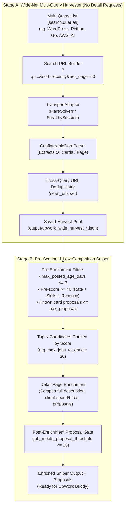

# Comprehensive Implementation Plan: Wide-Net Multi-Stack Scraping, Native URL Facets & Two-Stage Sniper Funnel

**Date**: 2026-10-20
**Scope**: Extending [`src/config_schema.py`](file:///var/www/upwork-scraper-fs/src/config_schema.py), [`src/orchestrator.py`](file:///var/www/upwork-scraper-fs/src/orchestrator.py), [`src/main.py`](file:///var/www/upwork-scraper-fs/src/main.py), [`src/proposal_engine.py`](file:///var/www/upwork-scraper-fs/src/proposal_engine.py), and [`configs/profiles/`](file:///var/www/upwork-scraper-fs/configs/profiles/) to maximize job discovery recall ("cast as wide a net as possible") while keeping detail-page enrichment fast, targeted, and filtered to low-competition opportunities (`max_proposals`).

---

## 1. Executive Summary & Architectural Goals

Currently, each scraping profile in [`configs/profiles/`](file:///var/www/upwork-scraper-fs/configs/profiles/) executes a **single search query** (`search.query`), fetches **10 jobs per page** (UpWork's default when `per_page` is omitted), and only covers 5 frontend/CMS stacks (`wordpress`, `laravel`, `dotnet`, `react`, `angular`).

To cast the widest possible net across all high-value skills in your portfolio without burning FlareSolverr/proxy capacity on low-value or high-competition jobs, we will implement four coordinated upgrades:

1. **Multi-Query Sweep Engine (`search.queries`)**: Allow any profile (or CLI invocation) to sweep a list of synonym/adjacent queries (e.g., `["wordpress", "woocommerce", "acf", "sage"]` or a cross-stack sweep) in a single run, automatically deduplicating jobs by canonical URL across all queries.
2. **High-Density Pagination & Native URL Search Facets (`per_page=50`, `contractor_tier`, `t`, `proposals`)**: Support UpWork's native search URL query parameters to pull up to **50 job cards per page load** (5x reduction in browser page loads) and optionally pre-filter by experience level, contract type, or proposal tiers on authenticated sessions.
3. **New Stack Profile Triads (`python`, `golang`, `devops_aws`, `ai_integration`)**: Add the complete 3-stage profile triads (`*_latest_50.yaml`, `*_multi_page.yaml`, `*_top20_enriched.yaml`) for your remaining core backend, infrastructure, scraping, and AI engineering stacks, plus corresponding proposal templates in [`src/proposal_engine.py`](file:///var/www/upwork-scraper-fs/src/proposal_engine.py).
4. **Two-Stage "Wide-Net Harvester $\rightarrow$ Low-Competition Sniper" Funnel**: Introduce two master cross-stack profiles (`all_stacks_wide_harvester.yaml` and `all_stacks_sniper_enriched.yaml`) that decouple broad card harvesting from targeted detail-page enrichment and `max_proposals` filtering.

---

## 2. End-to-End Architecture Diagram



---

## 3. Phase 1: Schema & Orchestrator Extensions for Multi-Query & URL Facets

### 3.1 Extend `SearchWorkflowConfig` in [`src/config_schema.py`](file:///var/www/upwork-scraper-fs/src/config_schema.py)
Add multi-query support and native UpWork URL parameters while keeping `query: str` 100% backward-compatible:

```python
class SearchWorkflowConfig(BaseModel):
    """Search, pagination, and data-source parameters."""

    mode: Literal["live_search", "from_saved_output"] = "live_search"
    query: str = "golang developer"
    queries: list[str] = Field(default_factory=list)
    sort: Literal["recency", "relevance"] | None = None
    per_page: Literal[10, 20, 50] | None = None
    contractor_tier: list[Literal[1, 2, 3]] = Field(default_factory=list)  # 1=Entry, 2=Intermediate, 3=Expert
    contract_type: Literal["hourly", "fixed"] | None = None  # Maps to t=0 (hourly) or t=1 (fixed)
    proposal_tiers: list[str] = Field(default_factory=list)  # e.g. ["0-4", "5-9", "10-14"] (Auth sessions only)
    start_page: int = 1
    max_pages: int = 1
    target_jobs: int | None = None
    delay_between_pages_seconds: float = 5.0
    deduplicate_by_url: bool = True
    input_saved_file: str | None = None

    def effective_queries(self) -> list[str]:
        """Return deduplicated list of queries to execute."""
        if self.queries:
            return list(dict.fromkeys(q.strip() for q in self.queries if q.strip()))
        return [self.query]
```

### 3.2 Extend `FilterWorkflowConfig` in [`src/config_schema.py`](file:///var/www/upwork-scraper-fs/src/config_schema.py)
Add negative keyword filtering (`exclude_keywords`) and contract-type/minimum-rate guards so wide-net sweeps can immediately drop irrelevant or ultra-low-budget posts before detail enrichment:

```python
class FilterWorkflowConfig(BaseModel):
    """Pre- or post-scoring candidate filters."""

    required_keywords: list[str] = Field(default_factory=list)
    exclude_keywords: list[str] = Field(default_factory=list)
    min_score: int | None = None
    max_posted_age_days: int | None = None
    max_proposals: int | None = None
```

### 3.3 Update `_run_live_search()` in [`src/orchestrator.py`](file:///var/www/upwork-scraper-fs/src/orchestrator.py)
1. **Multi-Query Loop with Shared `seen_urls`**:
   - Iterate over `self.profile.search.effective_queries()`.
   - Maintain a single `seen_urls: set[str]` across all queries in the run so a job matching both `"wordpress"` and `"woocommerce"` is only collected and enriched once.
   - Support `target_jobs` globally across the run (or per-query when configured).
2. **URL Parameter Construction Helper (`_build_search_url(query: str, page: int) -> str`)**:
   - Base: `https://www.upwork.com/nx/search/jobs/?q={safe_query}`
   - If `sort`: append `&sort={sort}`
   - If `per_page`: append `&per_page={per_page}`
   - If `contractor_tier`: append `&contractor_tier={','.join(map(str, contractor_tier))}`
   - If `contract_type == "hourly"`: append `&t=0`; if `"fixed"`: append `&t=1`
   - If `proposal_tiers` and `transport.adapter == "stealthy_session"`: append `&proposals={','.join(proposal_tiers)}` (guarded to `stealthy_session` because our Phase 1 UI research proved `&proposals=` redirects unauthenticated sessions to `/ab/account-security/login`).
   - Append `&page={page}`.

### 3.4 CLI Flags in [`src/main.py`](file:///var/www/upwork-scraper-fs/src/main.py)
Add ergonomic CLI overrides for agents and manual runs:
- `--queries` (comma-separated or repeatable `--query` flag, e.g., `--queries "python scraper,fastapi,playwright"`)
- `--per-page` (`choices=[10, 20, 50]`)
- `--exclude-keywords` (comma-separated negative keywords, e.g., `"tutor,homework,unpaid"`)

---

## 4. Phase 2: Expanding Stack Profile Triads (`configs/profiles/`)

Currently, your portfolio in [`src/proposal_engine.py`](file:///var/www/upwork-scraper-fs/src/proposal_engine.py#L148-L185) highlights strong experience in **Python/Scraping**, **Golang/PostgreSQL**, **AWS/DevOps/Terraform**, and **AI/LLM Integrations**, but there are no profile configs for them. We will create **4 new profile triads (12 YAML files)** plus **2 cross-stack funnel profiles**:

### 4.1 Python, Scraping & Backend Automation Triad
| Profile File | Mode & Queries | Pages / Target | Filters & Enrichment |
| :--- | :--- | :--- | :--- |
| `configs/profiles/python_latest_50.yaml` | `live_search`: `["python developer", "fastapi", "python scraper", "playwright"]` | `per_page: 50`, `max_pages: 1`, `target_jobs: 50`, `sort: recency` | `enrichment.enabled: false` |
| `configs/profiles/python_multi_page.yaml` | `live_search`: `["python developer", "python scraping", "fastapi postgresql"]` | `per_page: 50`, `max_pages: 4`, `target_jobs: 200`, `sort: recency` | `enrichment.enabled: false` |
| `configs/profiles/python_top20_enriched.yaml` | `from_saved_output` | Top 20 candidates | `required_keywords: ["python", "fastapi", "django", "scraper", "playwright", "scrapy", "automation"]`, `min_score: 40`, `max_posted_age_days: 14`, `max_proposals: 15`, `enrichment.enabled: true` |

### 4.2 Golang & Backend Microservices Triad
| Profile File | Mode & Queries | Pages / Target | Filters & Enrichment |
| :--- | :--- | :--- | :--- |
| `configs/profiles/golang_latest_50.yaml` | `live_search`: `["golang", "go developer", "golang api"]` | `per_page: 50`, `max_pages: 1`, `target_jobs: 50`, `sort: recency` | `enrichment.enabled: false` |
| `configs/profiles/golang_multi_page.yaml` | `live_search`: `["golang", "go backend", "golang microservices"]` | `per_page: 50`, `max_pages: 4`, `target_jobs: 200`, `sort: recency` | `enrichment.enabled: false` |
| `configs/profiles/golang_top20_enriched.yaml` | `from_saved_output` | Top 20 candidates | `required_keywords: ["golang", "go", "microservice", "grpc", "postgresql", "backend"]`, `min_score: 40`, `max_posted_age_days: 14`, `max_proposals: 15`, `enrichment.enabled: true` |

### 4.3 DevOps, AWS, Terraform & Linux Infrastructure Triad
| Profile File | Mode & Queries | Pages / Target | Filters & Enrichment |
| :--- | :--- | :--- | :--- |
| `configs/profiles/devops_aws_latest_50.yaml` | `live_search`: `["aws terraform", "devops docker", "ansible linux", "aws infrastructure"]` | `per_page: 50`, `max_pages: 1`, `target_jobs: 50`, `sort: recency` | `enrichment.enabled: false` |
| `configs/profiles/devops_aws_multi_page.yaml` | `live_search`: `["aws terraform", "devops engineer", "docker nginx", "ci cd pipeline"]` | `per_page: 50`, `max_pages: 4`, `target_jobs: 200`, `sort: recency` | `enrichment.enabled: false` |
| `configs/profiles/devops_aws_top20_enriched.yaml` | `from_saved_output` | Top 20 candidates | `required_keywords: ["aws", "terraform", "docker", "devops", "linux", "nginx", "ansible", "ci/cd"]`, `min_score: 40`, `max_posted_age_days: 14`, `max_proposals: 15`, `enrichment.enabled: true` |

### 4.4 AI, LLM APIs & Workflow Automation Triad
| Profile File | Mode & Queries | Pages / Target | Filters & Enrichment |
| :--- | :--- | :--- | :--- |
| `configs/profiles/ai_integration_latest_50.yaml` | `live_search`: `["claude api", "openai api", "ai agent python", "llm integration"]` | `per_page: 50`, `max_pages: 1`, `target_jobs: 50`, `sort: recency` | `enrichment.enabled: false` |
| `configs/profiles/ai_integration_multi_page.yaml` | `live_search`: `["claude api", "openai integration", "ai workflow automation", "rag python"]` | `per_page: 50`, `max_pages: 4`, `target_jobs: 200`, `sort: recency` | `enrichment.enabled: false` |
| `configs/profiles/ai_integration_top20_enriched.yaml` | `from_saved_output` | Top 20 candidates | `required_keywords: ["ai", "llm", "claude", "openai", "gpt", "agent", "rag", "langchain", "automation"]`, `min_score: 40`, `max_posted_age_days: 7`, `max_proposals: 15`, `enrichment.enabled: true` |

### 4.5 Upgrade Existing WordPress, Laravel, .NET, React & Angular Profiles
- Add synonym queries to `wordpress_multi_page.yaml` (`["wordpress", "woocommerce", "acf gutenberg", "wordpress speed optimization"]`) and set `per_page: 50`.
- Add `max_proposals: 15` to all `*_top20_enriched.yaml` profiles (`wordpress_top20_enriched.yaml`, `laravel_top20_enriched.yaml`, `dotnet_top20_enriched.yaml`, `react_top20_enriched.yaml`, `angular_top20_enriched.yaml`) so every enrichment profile automatically filters out high-competition jobs (`15 to 20`, `20 to 50`, `50+`).

---

## 5. Phase 3: Master Cross-Stack "Harvester $\rightarrow$ Sniper" Funnel Profiles

To allow an agent (or cron job) to sweep **all** of your target markets in two commands:

### 5.1 Stage A: `configs/profiles/all_stacks_wide_harvester.yaml`
Sweeps all core stacks sorted by recency at 50 cards per page with **no detail-page overhead**:
```yaml
name: "all_stacks_wide_harvester"
description: "Cast the widest net across WordPress, Python/Scraping, Golang, DevOps/AWS, and Full-Stack with 50 cards/page"
selectors_file: "configs/selectors/upwork.yaml"

transport:
  adapter: "flaresolverr"
  proxy_mode: "rotation"
  max_timeout_ms: 60000
  max_retries: 3
  retry_backoff_seconds: 2.0

search:
  mode: "live_search"
  query: "wordpress developer"
  queries:
    - "wordpress developer"
    - "woocommerce fix"
    - "python scraper"
    - "fastapi developer"
    - "golang developer"
    - "aws terraform"
    - "laravel developer"
    - "react typescript"
  sort: "recency"
  per_page: 50
  contractor_tier: [2, 3]
  start_page: 1
  max_pages: 2
  target_jobs: 400
  delay_between_pages_seconds: 4.0
  deduplicate_by_url: true

filters:
  exclude_keywords:
    - "unpaid"
    - "homework"
    - "tutor"
  max_posted_age_days: 7

enrichment:
  enabled: false

output:
  directory: "output"
  filename_prefix: "upwork_wide_harvest"
  save_per_page: false
  save_combined: true
```

### 5.2 Stage B: `configs/profiles/all_stacks_sniper_enriched.yaml`
Reads the harvested pool, pre-scores all candidates by rate, portfolio skill match, and recency, enriches the **top 25 candidates**, and strictly enforces `max_proposals: 15`:
```yaml
name: "all_stacks_sniper_enriched"
description: "Score harvested jobs across all stacks, enrich top 25 details, and filter to <= 15 proposals"
selectors_file: "configs/selectors/upwork.yaml"

transport:
  adapter: "flaresolverr"
  proxy_mode: "rotation"
  max_timeout_ms: 60000
  max_retries: 3
  retry_backoff_seconds: 2.0

search:
  mode: "from_saved_output"
  query: "all_stacks"
  deduplicate_by_url: true

filters:
  exclude_keywords:
    - "unpaid"
    - "homework"
    - "tutor"
  min_score: 45
  max_posted_age_days: 7
  max_proposals: 15

enrichment:
  enabled: true
  max_jobs_to_enrich: 25
  detail_retries: 2
  delay_between_details_seconds: 2.0
  compute_proposal_scores: true

output:
  directory: "output"
  filename_prefix: "upwork_all_stacks_sniper_top25"
  save_per_page: false
  save_combined: true
```

---

## 6. Phase 4: Proposal Engine Enhancements for New Stacks (`src/proposal_engine.py`)

To ensure the wider net produces equally strong proposals and scoring across the new stacks:
1. **Expand `PORTFOLIO_KEYWORDS` & `PORTFOLIO_REFERENCES`** in [`src/proposal_engine.py`](file:///var/www/upwork-scraper-fs/src/proposal_engine.py#L148-L185):
   - Add DevOps/Cloud keywords (`"terraform"`, `"ansible"`, `"ci/cd"`, `"github actions"`, `"cloudflare"`, `"ubuntu"`) and AI keywords (`"llm"`, `"openai"`, `"claude"`, `"anthropic"`, `"rag"`, `"langchain"`).
2. **Add Dedicated Proposal Generators**:
   - Add `_proposal_devops(title, problem)` and `_proposal_ai_integration(title, problem)` in [`generate_proposal()`](file:///var/www/upwork-scraper-fs/src/proposal_engine.py#L380-L404) alongside the existing WordPress, Python, and Golang templates.

---

## 7. Implementation & Verification Checklist

1. **Step 1 — Schema & URL Builder (`src/config_schema.py`, `src/orchestrator.py`, `src/main.py`)**:
   - Add `queries`, `per_page`, `contractor_tier`, `contract_type`, `proposal_tiers` to `SearchWorkflowConfig`.
   - Add `exclude_keywords` to `FilterWorkflowConfig`.
   - Implement `_build_search_url()` and multi-query loop in `ConfigurableScraper._run_live_search()`.
   - Add `--queries`, `--per-page`, and `--exclude-keywords` CLI flags to `src/main.py`.
2. **Step 2 — Profile Configurations (`configs/profiles/*.yaml`)**:
   - Create the 12 new stack profiles (`python_*`, `golang_*`, `devops_aws_*`, `ai_integration_*`).
   - Create `all_stacks_wide_harvester.yaml` and `all_stacks_sniper_enriched.yaml`.
   - Update existing `*_top20_enriched.yaml` profiles with `max_proposals: 15`.
3. **Step 3 — Proposal Engine Templates (`src/proposal_engine.py`)**:
   - Add DevOps/AWS and AI integration keywords and proposal templates.
4. **Step 4 — Automated Tests (`tests/test_adapters_and_config.py`)**:
   - Test multi-query execution and cross-query URL deduplication.
   - Test URL parameter generation (`per_page=50`, `contractor_tier`, `t=0/1`, `proposal_tiers` auth guard).
   - Test `exclude_keywords` filtering.
   - Validate all new YAML profiles in `test_load_all_profile_configs()`.
   - Run `uv run pytest -v`, `uv run ruff check src/ tests/`, and `uv run pyright src/ tests/`.
